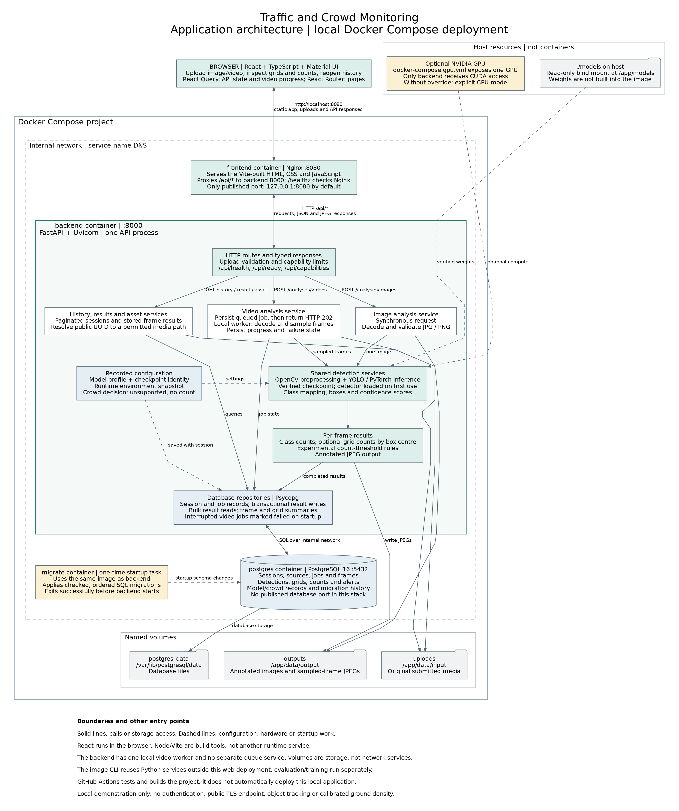

# Traffic and Crowd Monitoring Application

We are building this application for a BSc thesis on analysing aerial images
and videos. It detects objects, counts them across image regions and stores
the results so we can inspect them later in a browser.

**The application works as an experimental analysis tool. Its selected detector
has not passed our accuracy requirements, and dense-crowd counting is currently
unsupported.** A completed analysis means processing finished, not that every
object was correctly detected.



*The current local application, including its Docker boundaries and storage.
[Open the full-size diagram](docs/diagrams/application_architecture.svg),
read the [architecture guide](docs/architecture.md#the-running-application),
or see the [application screenshots](docs/user_guide.md).*

## What We Can Do

- Submit an image or video through the browser.
- Inspect detections, class counts and counts within a selected grid cell.
- Browse sampled video frames with their source timestamps.
- Reopen saved analyses from session history.
- Read the model settings and experimental threshold events stored with a run.

The [illustrated user guide](docs/user_guide.md) follows an image from upload
to its saved result. Video counts belong to individual sampled frames; they
are not totals of unique vehicles or people across a recording.

## Run the Application

The complete application runs locally with Docker Compose. We need Docker
Compose v2, a configured `.env` and the verified model weights before starting.
The GPU option also needs NVIDIA support in Docker.

From the repository root, create `.env` only if it does not already exist:

```bash
cp -n .env.example .env
```

Choose a local database password in `.env`. The selected checkpoint belongs at
`models/candidates/yolo26m-visdrone/best.pt`; it is not included in Git.
The [local setup guide](docs/local_development.md#running-the-project-locally)
explains how we download and verify it.

For our NVIDIA setup:

```bash
docker compose -f docker-compose.app.yml -f docker-compose.gpu.yml up -d --build --wait --wait-timeout 240
```

Open **<http://localhost:8080>**. For CPU execution, omit
`-f docker-compose.gpu.yml`. The [Compose guide](docs/compose_stack.md) covers
prerequisites, storage, shutdown and troubleshooting. The application is a
localhost demonstration without authentication, not a public hosting setup.

## How It Fits Together

We run three long-lived containers and one short-lived migration task:

| Service | Its role |
| --- | --- |
| `frontend` | Nginx serves the built React application and forwards `/api/` requests to the backend. Only this service publishes a localhost port. React itself runs in the browser. |
| `backend` | One FastAPI process validates uploads, runs detection, stores results and serves saved media. Video work runs in a local background worker inside this container. |
| `postgres` | PostgreSQL stores sessions, job progress, frame records, detections, counts, grids, alerts and model information. It is reached through the internal Docker network. |
| `migrate` | Uses the backend image to apply ordered SQL migrations, then exits before the backend starts. |

An image request runs validation, OpenCV preprocessing, YOLO inference and
counting before returning its saved result. A video request first creates a
persistent job and returns HTTP `202`. The background worker samples frames,
processes them through the same detection services and updates progress while
the browser polls the job. Completed results can be reopened without repeating
inference.

The database stores structured records and media references, not the image or
video bytes. Three named volumes keep database files, uploads and generated
images separate. Model weights come from a read-only host mount. The GPU
override gives NVIDIA access only to the backend; without it, the stack uses
CPU mode explicitly.

Compose waits for PostgreSQL readiness, successful migrations and backend
readiness before starting Nginx. The
[Docker build and startup diagram](docs/architecture.md#how-docker-builds-and-starts-the-app)
shows that order. Our [database ER diagram](docs/database/database_schema.md#how-the-tables-are-connected)
shows the tables, keys and relationships behind the stored results.

## Documentation

| What you need | Where to start |
| --- | --- |
| See and use the application | [User guide](docs/user_guide.md) |
| Run the complete stack | [Docker Compose](docs/compose_stack.md) |
| Change or test the code | [Local development](docs/local_development.md) and [development workflow](docs/development_workflow.md) |
| Use the API or image CLI | [API reference](docs/api.md) and [command-line processing](docs/command_line.md) |
| Understand the data model | [Database schema](docs/database/database_schema.md) |
| Find thesis metrics and experiment decisions | [Evaluation results index](docs/evaluation/results_index.md) |
| Find the remaining work | [Quality roadmap](quality_roadmap.md) |

The [documentation index](docs/README.md) separates current guides from dated
verification reports and development history.

## Limits We Keep Visible

The detector can miss or misclassify small aerial objects. The
[recorded held-out evaluation](docs/evaluation/final_quality_gate.md) failed its
overall quality gate; the new evaluation work has not produced replacement
accuracy results. Dense-crowd analysis returns an unsupported status and no
count, rather than a misleading zero.

Grid counts describe regions of an image, not people or vehicles per square
metre. Threshold events do not establish congestion, overcrowding or danger.
Video jobs run in one API process; interrupted jobs are marked failed at the
next startup rather than resumed. We describe these boundaries in the
[user guide](docs/user_guide.md#reading-the-results-carefully) and
[operational guide](docs/operational_safeguards.md).
