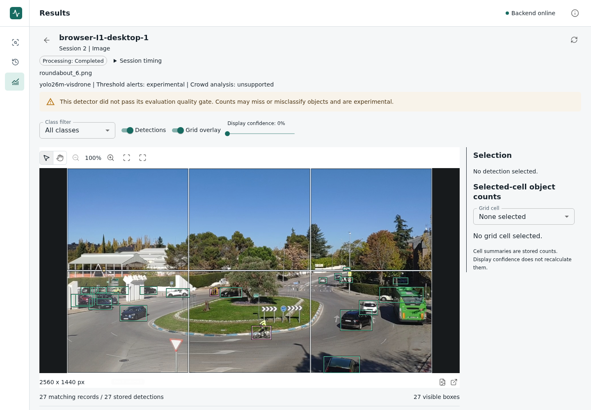
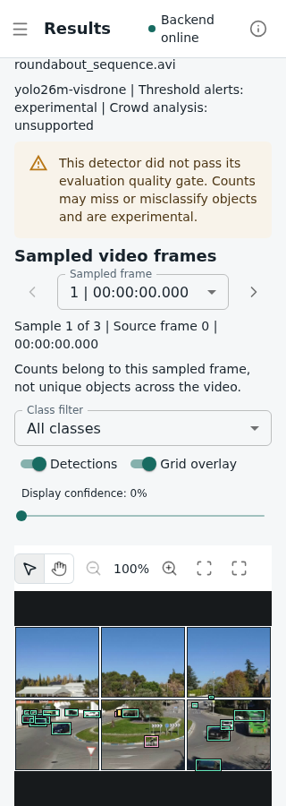

# Browser Result Readiness

[Results index](results_index.md) | [System evaluation plan](system_evaluation_plan.md)

We now measure the browser path from submitting an analysis to a decoded image
with correctly placed detection and grid overlays. This complements the
[API timings](system_measurements.md) and [backend restart timings](system_restarts.md).
The check on 9 November 2026 verifies the measurement tool. It is **not the final
thesis performance experiment**, and #79 remains open.

## What the Timer Includes

The browser's monotonic clock starts at the captured **Start analysis** click,
before the application's handler runs. It stops once the clean image is decoded
and the scene has the same geometry over two successive animation-frame samples.
The overlay group and its buttons must have visible layout, and the expected
number of grid cells must exist. A scene with zero detections is valid.

After the timer stops, we compare that scene with the saved API result: clean
asset URL, image dimensions, detection IDs, box geometry and grid geometry.
Geometry must agree within one CSS pixel. A mismatch is a failed attempt, even
if the upload returned success. For video, we check the first sampled frame;
we do not claim that every frame has already been displayed.

This is **rendered-scene readiness, not physical screen paint**. A decoded scene
may extend below the viewport. Each observation records `inViewport` for the
whole image; the runner does not scroll while timing. Screenshots are taken
afterwards, with the scene scrolled into view. They illustrate the result, not
the exact viewport position when the timer stopped.

Each attempt uses a fresh Chromium context. Opening the workspace, selecting
the file and filling the form happen before timing. Upload, processing, UI
navigation, result retrieval and image decoding are included. Video uses the
application's existing one-second polling interval and normal query behavior.
The runner never retries a failed submission. Browser instrumentation and
geometry checks add overhead; tracing is disabled.

## Running the Check

We use a disposable Compose project with its own database and media volumes.
The runner requires a labelled measurement backend, a frontend in the same
project, and an HTTP loopback URL matching its published port. The existing
verified model, Docker GPU support, the installed Python `.venv`, Node 24 or
newer, frontend dependencies and Playwright Chromium are prerequisites.
Dependency setup is in [local development](../local_development.md) and
[testing](../testing.md).

From the repository root, with port 8086 unused:

```bash
export POSTGRES_PASSWORD=local_browser_test_only
export BACKEND_IMAGE=traffic-browser-backend:local
export MEASUREMENT_FRONTEND_IMAGE=traffic-browser-frontend:local
export FRONTEND_PORT=8086
export APP_REVISION=$(git rev-parse HEAD)
export APP_SOURCE_DIRTY=true
export COMPOSE_PROJECT_NAME=traffic-browser-check
export COMPOSE_FILE=docker-compose.app.yml:docker-compose.gpu.yml:docker-compose.measurement.yml

docker compose --env-file /dev/null up -d --build --wait --wait-timeout 180
npm --prefix frontend run measure:browser -- \
  --base-url http://127.0.0.1:8086 \
  --backend-container traffic-browser-check-backend-1 \
  --frontend-container traffic-browser-check-frontend-1 \
  --repetitions 2 \
  --output-directory data/output/system-measurements/browser-check
```

The output directory must be new; paths are relative to the repository root.
This example deliberately marks a development build dirty. A final freeze
requires an actually clean commit, not just changing the flag.

Desktop (1440 by 1000) runs before the narrow viewport (320 by 900). Within each,
we run I1, I2 and V1 from the [scenario file](../../configs/evaluation/system_workflows.json),
with one excluded warm-up followed by measured repetitions. The default is ten;
two here check the tooling. The backend remains running between attempts.
Input hashes are verified. PNG/JPEG/AVI/MP4 MIME metadata is supplied explicitly
for small fixtures; files above 50 MiB use their local path. We capture and
verify the browser's selected file metadata before the app clears its input.
This does **not** resolve native file-chooser compatibility under #84.

The five-input candidate, including I3 and V2, is selected explicitly with
`--scenarios configs/evaluation/system_workflows_candidate.json`. Its source
requirements and checksums are in [system evaluation inputs](system_scenarios.md).
The old configuration remains the default for reproducing earlier checks.

The runner builds the local production frontend before collection, then compares
served HTML and asset hashes with that build. It verifies backend source and
saved-session provenance, stable model settings, and unchanged source, tool and
container identities. It writes:

- `report.json`: every attempt, browser timestamps, saved results, network request
  IDs, runtime details, served-file hashes and separate viewport summaries.
- `attempts.csv`: timing rows, including warm-ups and failed attempts.
- PNG screenshots and `sha256.json`: hashes of screenshots and result files.

`recorded` means evidence collection completed, not that performance or accuracy
passed. Failures remain in the denominator and stop further submissions with a
nonzero exit code. An abrupt interruption may leave an `in_progress` checkpoint;
we inspect it and any unfinished job before rerunning. Output is never overwritten.

After retaining the evidence, we remove only this disposable project:

```bash
docker compose --env-file /dev/null down --volumes --remove-orphans
```

## Verification on 9 November

The [tracked record](../../data/evaluation/browser_readiness_verification.json)
contains all 18 observations, settings, request/session IDs, source and artifact
hashes, and the separate GPU regression outcome. The full local report remains
under `data/output/system-measurements/browser-verification-2026-11-09/`.
The tracked record omits repeated full saved results and per-box geometry;
their original report hash and each saved-result hash retain that connection.
Saved-result hashes use UTF-8 `JSON.stringify(result)` in original key order.

We reused source-matching runtime images from the #26 checks. The runner tree
was dirty; backend commit metadata was unavailable, with its source hash and
immutable image ID retained instead. This is not a frozen release. Chromium
156.0.8078.4 ran on the same workstation for both viewport sizes, using the RTX
5060 Laptop GPU backend. Narrow-viewport results are not mobile-device benchmarks.

All six warm-ups and twelve measured attempts completed. Overlay checks and
served-bundle checks passed. These medians are **development verification only**:

| Scenario | Desktop samples | Median (s) | Narrow samples | Median (s) |
| --- | ---: | ---: | ---: | ---: |
| I1, image with grid | 2 | 0.2934 | 2 | 0.2612 |
| I2, image without grid | 2 | 0.2764 | 2 | 0.2602 |
| V1, artificial three-frame video | 2 | 1.1945 | 2 | 1.1938 |

The first desktop I1 warm-up took 19.4251 seconds and remains in the record,
excluded from these medians by the predefined warm-up rule. With two measured
observations, p95 is merely the larger observation. We cannot infer typical or
tail performance, or that the narrower view is faster. Order and warm caches
may affect the numbers. The local test suite had finished before collection,
but exclusive host/GPU use was not established.

The whole image was inside the viewport for I1 and I2, but not V1, in both sizes.
The screenshots below were captured after timing and scrolling. The model's
failed-quality-gate warning remains visible.





Source imagery: *Traffic Images Captured from UAVs*, Ghisler, Sanchez-Soriano
and Bemposta Rosende, CC BY 4.0. The [fixture record](../../data/runtime-regression/README.md)
links the source and licence. Screenshots add the application interface, boxes
and grid. V1 repeats still images on an artificial timeline; it is not natural
motion. Both image inputs belong to one scene group.

All 115 frontend unit tests and four evidence-rule tests passed. The 36 browser
checks passed twice without retries, including delayed decoding, zero
detections, missing media, displaced boxes and rejected uploads. Lint, types,
formatting and production build passed. The unchanged five-frame GPU regression
also passed. No application component, dependency, model setting or baseline
changed.

## Remaining Work

The [lifecycle runner](stack_lifecycle.md) now covers fresh-stack startup and
controlled idle outages. The [12 November input preparation](system_scenarios.md)
records I3, V2, the agreed recovery scope and combined run order. Input
compatibility, release dependency decisions, the software gate and version
freeze come before final collection. These checks neither improve the
failed detector quality gate nor add dense-crowd support.
