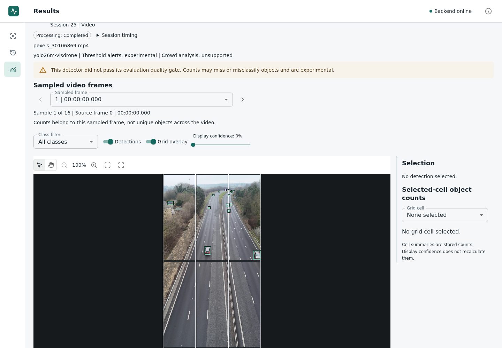
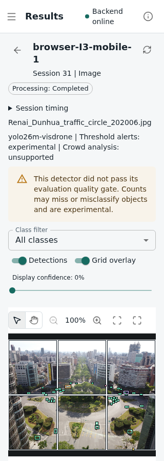

# System Evaluation Inputs

[Results index](results_index.md) | [Evaluation plan](system_evaluation_plan.md)

We prepared the five workflow scenarios on 12 November 2026. This gives the
final application experiment a defined input set without starting another
annotation task. It does not add accuracy scores, change the detector or
complete the release freeze.

The [candidate configuration](../../configs/evaluation/system_workflows_candidate.json)
contains I1, I2, I3, V1 and V2 in that order. The earlier
[three-scenario file](../../configs/evaluation/system_workflows.json) stays
unchanged, so previous development checks can still be reproduced.

## What We Added

| Scenario | Source file | Decoded input | Settings |
| --- | --- | --- | --- |
| I3 | MiNe's Ren'ai traffic-circle photograph | JPEG, 2160 by 1620, 2,802,162 bytes | 2-by-3 grid |
| V2 | David Pickup's Pexels highway clip, ID 30106869 | H.264 MP4, 2160 by 3840, 369,380,661 bytes | 2-by-3 grid, two-second sampling |

I3 already belongs to our validation material. Its file matches the recorded
checksum; we did not crop or re-encode it. We use decoded dimensions rather
than the original-camera dimensions in historical EXIF metadata.

V2 is the original publisher download. OpenCV 4.13.0 decoded all 907 frames,
matching the reported count. Reported FPS is 30000/1001, giving a nominal
30.2636 seconds from frame count divided by FPS. This is not a timestamp audit.
Source previews at approximately 0, 10, 20 and 29 seconds show daylight road
traffic and changing vehicle positions. Unlike V1, it is not our constructed
still-image sequence. It does not establish tracking accuracy.

We selected the clip for its documented source, daylight road scene, portrait
orientation, duration and compatibility with existing upload limits. We fixed
two-second sampling before running detections: the current sampler rounds this
to every 60th source frame, giving 16 sampled frames. We did not select it for
good detector output or favourable timing. There are no new reference labels.

The [source record](../../data/evaluation/system_scenario_sources.json) contains
the exact paths, SHA-256 hashes, creator, download URL, licence links, decoding
metadata and exclusions. I1, I2 and V1 retain their existing
[runtime-fixture attribution](../../data/runtime-regression/README.md).
Together the five scenarios cover only three source groups.

## Sources and Permissions

I3 is by MiNe, under [CC BY 2.0](https://creativecommons.org/licenses/by/2.0/),
as recorded on its [Wikimedia source page](https://commons.wikimedia.org/wiki/File:Ren%27ai_Dunhua_traffic_circle_202006.jpg).
Figures using it retain attribution and explain that the application adds
boxes, grids or interface elements.

V2 is *Aerial View of Busy Highway Traffic in Daylight*, by David Pickup |
Advertising & Marketing, on [Pexels](https://www.pexels.com/video/aerial-view-of-busy-highway-traffic-in-daylight-30106869/).
We checked the [Pexels License](https://www.pexels.com/license/) and
[terms](https://www.pexels.com/terms-of-service/) dated 20 October 2026. It is
not Creative Commons or public-domain material. We keep the raw clip and
unmodified extracted frames outside Git; the publisher remains the download
source. Contextual application figures retain the source credit and do not
suggest endorsement. The licence does not guarantee every third-party right.

The old `data/input/test_video.mp4` is excluded because its source and licence
are unknown. Ali confirmed that the original link is unavailable. We also
exclude Jane Byrne because its sampled images belong to the historical held-out
group. Neither exclusion deletes local files or changes earlier results.

## Using the Candidate

The media files are ignored by Git. A fresh checkout needs the unchanged source
files at the paths in the source record, obtained through the linked publishers.
The runner rejects missing files or checksum mismatches instead of silently
using another download. From the repository root, we can verify all five:

```bash
.venv/bin/python -c 'from pathlib import Path; from evaluation.system_measurement import load_scenarios; print([s.scenario_id for s in load_scenarios(Path("configs/evaluation/system_workflows_candidate.json"))])'
```

Expected output is `['I1', 'I2', 'I3', 'V1', 'V2']`. The warm, restart, lifecycle
and browser runners accept this same explicit option:

```text
--scenarios configs/evaluation/system_workflows_candidate.json
```

The [browser guide](browser_readiness.md), [warm guide](system_measurements.md),
[restart guide](system_restarts.md) and [lifecycle guide](stack_lifecycle.md)
provide the other arguments and disposable-stack requirements. Their default
remains the earlier three-input configuration.

Small browser fixtures use explicit PNG/JPEG/AVI/MP4 MIME metadata. Files above
Playwright's 50 MiB payload limit use a local file path; the runner checks the
selected browser file's name, size and MIME before submission. These setup
checks are outside the click-to-scene timer. V2 therefore exercises a native
MP4 path, but does not resolve all file-chooser compatibility under #84.

## Before Final Collection

The [verification record](../../data/evaluation/system_scenario_verification.json)
now links the retained local reports and their verified artifact hashes. The
first 12 November attempt stopped before submission because the runner read
file metadata after the application cleared its input. The second completed
14 attempts, then rejected the narrow I3 scene: a CSS border enlarged a tiny
detection box beyond its stored geometry. PR #167 fixed the event capture and
replaced detection borders with inset shadows, without relaxing the alignment
tolerance. The corrected run completed all 20 attempts: one warm-up and one
measured submission for every scenario at each viewport size.

The separate five-frame GPU regression passed without differences. These are
compatibility checks, not final timing samples or proof of detector accuracy.
The screenshot below shows the first of V2's 16 sampled frames, after scrolling
to the scene. The original portrait aspect ratio is preserved.



Source: David Pickup | Advertising & Marketing,
[Pexels video 30106869](https://www.pexels.com/video/aerial-view-of-busy-highway-traffic-in-daylight-30106869/),
[Pexels License](https://www.pexels.com/license/). The application adds the
interface, detections and grid. This is a 12 November development screenshot,
not a new accuracy reference or an endorsement by the contributor.



Source: MiNe, [Ren'ai traffic circle](https://commons.wikimedia.org/wiki/File:Ren%27ai_Dunhua_traffic_circle_202006.jpg),
[CC BY 2.0](https://creativecommons.org/licenses/by/2.0/). The application adds
the interface, detections and grid. The screenshot was taken after the tiny-box
fix on 12 November. It is a narrow desktop-browser viewport, not a mobile-device
performance test.

The [evaluation plan](system_evaluation_plan.md) fixes the phase order and
repetitions. Ali approved live recovery tests limited to idle service outages;
interrupted videos remain covered by controlled software tests, with no claimed
real-GPU crash-recovery timing. Compatibility evidence is separate from final
performance collection. The [13 November dependency decision](release_dependency_review.md)
retains current versions. The final software gate and a clean version/configuration
freeze still precede collection. Issue #79 remains open.
