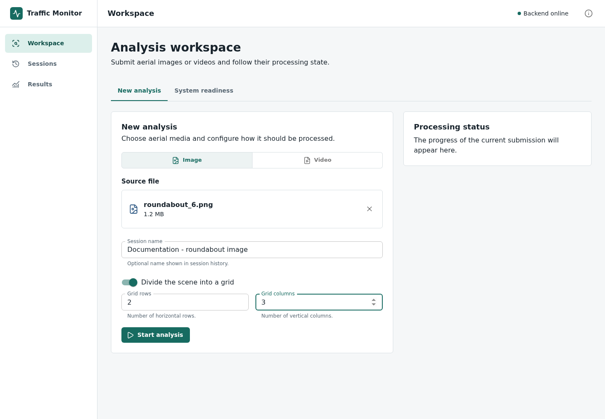
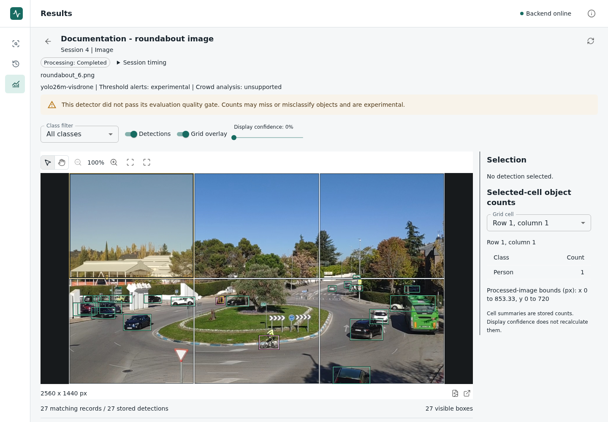
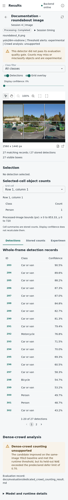
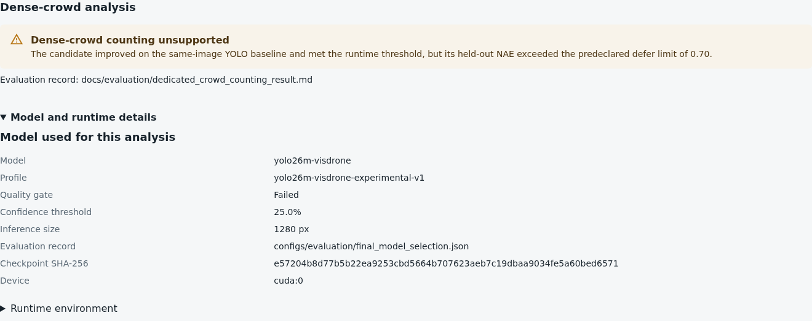
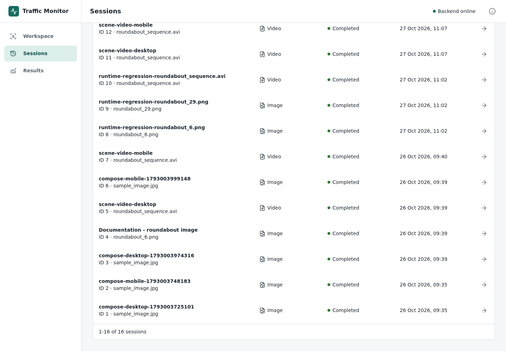

# Using the Application

[Documentation index](README.md)

We use the browser to submit aerial media, inspect the results and return to
previous analyses. This walkthrough follows a real image run through the local
application. The scene-first workspace keeps the media, interactive layers and
selected-object details together.

The screenshots use an attributed development image from *Traffic images
captured from UAVs*. The boxes are model predictions, not reference annotations.
The [screenshot record](images/user-guide/README.md) gives the source, application
version and capture details.

## Start with an Image

With the application running, open <http://localhost:8080> and choose the
workspace. A different `FRONTEND_PORT` changes that address; the documentation
capture used port 8083. The [Compose guide](compose_stack.md) covers first setup.

1. Choose **Image** and select a JPG or PNG file.
2. Give the session a name so it is easy to recognise later.
3. Enable **Divide the scene into a grid** to compare image regions. We use
   two rows and three columns in this example.
4. Select **Start analysis**. When processing finishes, the browser opens the
   saved result.

*The submission form sets the media and grid layout. Model settings come from
the backend's recorded profile, not from this form.*

## Inspect the Result

The result page keeps whole-image counts separate from counts for a selected
cell. Selecting a cell on the image or in **Grid cell** changes the cell table.
The **Grid overlay** switch hides the grid without changing stored results.

*We can compare one part of the scene with the complete image. The warning above
the result remains visible because this detector failed its quality gate.*

**Class filter** changes the interactive boxes and matching records. We can
hide detection or grid layers, zoom, fit the image, and switch to the hand tool
to pan. Selecting a box or a detection row opens its class, confidence and
coordinates in the inspector. Selecting a grid cell shows its stored summaries.

**Display confidence** hides lower-scoring records; it does not rerun the model,
recover detections below the original inference threshold, or recalculate stored
summaries and alerts. Matching records and the all-class stored total are shown
separately. The tabs below the scene contain detections, stored counts and
experimental alerts. Older sessions retain a labelled annotated preview whose
baked-in boxes cannot be hidden or filtered.

On a narrow screen, the inspector sits below the scene:

Further down, the page records the model used and the dense-crowd decision:

*Unsupported crowd counting is not a measured count of zero. Successful
processing and model accuracy are different things.*

## Reopen a Saved Analysis

Open **Sessions**, find the session name and use its arrow button.
The application retrieves the saved result; it does not run the detector again.

*Session history connects the submitted file, processing status and stored
result. Session IDs and dates will differ on another installation.*

## Try a Video

The same workspace accepts MP4, AVI, MOV and MKV files in **Video** mode.
The **Sampling interval** sets the time between analysed frames. After
submission, the browser reports the background job's progress.

On a completed video result, **Sampled frame** and the previous/next arrows
move between processed frames. Each has its own source timestamp, detections
and counts. We do not add frame counts together as unique road users, and the
current view is a sampled-frame browser rather than continuous video playback.

## Reading the Results Carefully

| What the application shows | What it means |
| --- | --- |
| Processing completed | The processing job finished, not that every prediction is correct |
| Object count | The number of detections recorded for that class and frame |
| Grid-cell count | Detections assigned by box centre to a region in image coordinates |
| Confidence | A model score, not a guarantee that the label is correct |
| Experimental threshold event | A predicted count met a configured software threshold |
| Dense-crowd analysis unsupported | No accepted crowd-counting method is active; there is no crowd estimate |

Grid cells have no ground-area calibration, so these are not counts per square
metre. An event does not establish congestion, overcrowding or an emergency.
Actual accuracy measurements belong in the
[evaluation results index](evaluation/results_index.md), not in these screenshots.

## When Something Goes Wrong

- **Service unavailable:** check the application containers and `/api/ready` as
  described in the [Compose guide](compose_stack.md). A running frontend alone
  does not mean the database and detector are ready.
- **File rejected:** check its format and the limits shown in the form. Limits
  come from the API and may differ between installations.
- **Video job failed:** read its message and check session history before
  submitting again. Interrupted jobs do not resume automatically after restart.
- **Result image unavailable:** stored counts may still be readable. Database
  records and media files are separate, so both need to be retained.

Closing the browser or stopping an upload does not guarantee cancellation of
server work already accepted. The API has no video-job cancellation endpoint.
